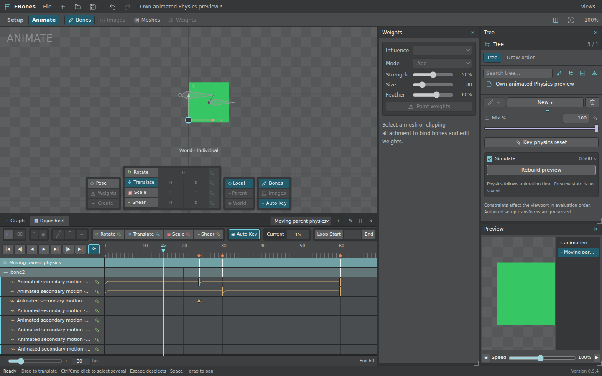
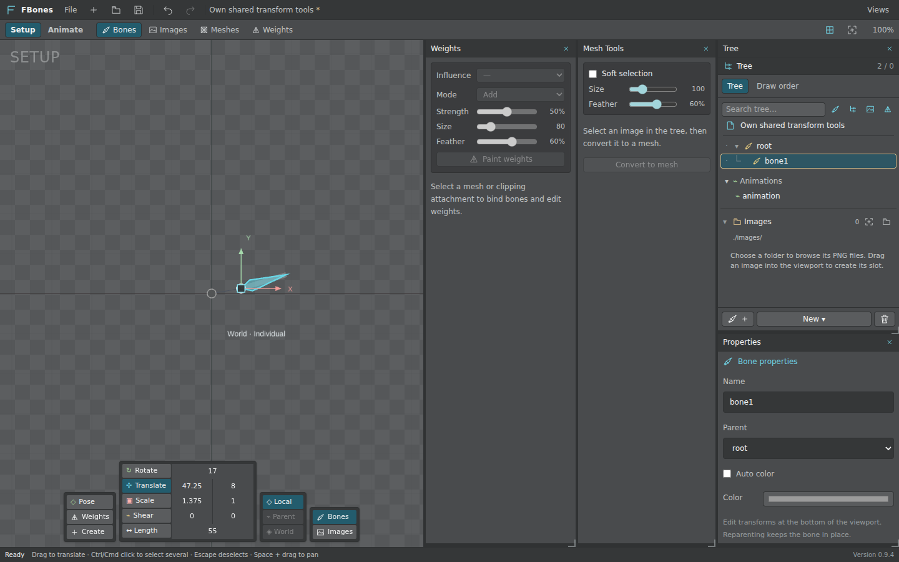
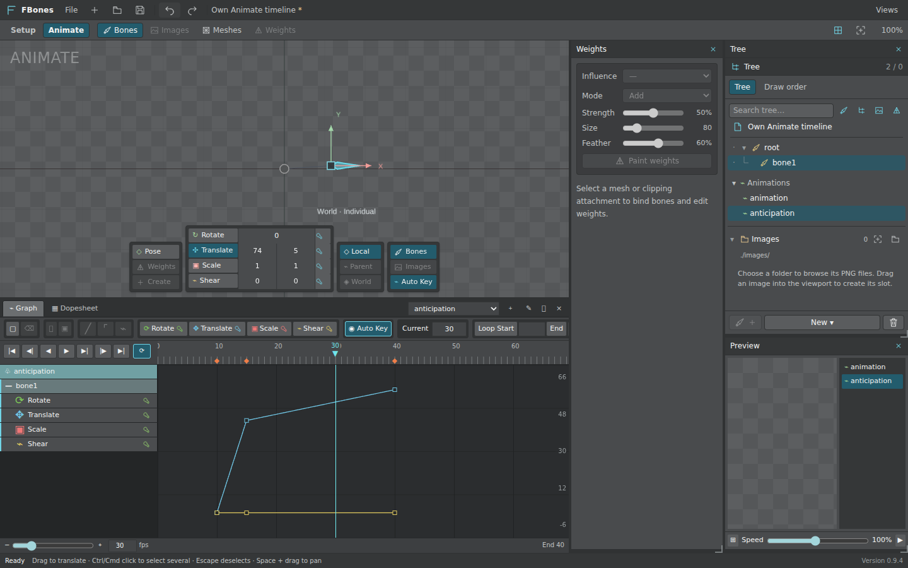

<div align="center">

# FBones

**A free, open-source desktop alternative for 2D skeletal animation.**

Build rigs, paint weights, and animate offline with an editor built for Windows, macOS, and Linux.

[Getting started](#getting-started) · [Developer runtime](#developer-runtime-preview) · [Implementation status](#implementation-status) · [Contributing](CONTRIBUTING.md) · [Roadmap](docs/ROADMAP.md) · [Builds](https://github.com/Malasuerte94/FBones/actions/workflows/desktop.yml)

**0.9.4 · Early beta · MIT licensed**

</div>



FBones is an independent animation editor built with **Tauri 2, Rust, Vue 3, TypeScript, and PixiJS 8/WebGL**. It runs locally; the editor does not require an account, subscription, or cloud service.

The goal is a practical, community-built alternative to Spine for creating 2D skeletal animation. **This is an early beta, not a finished replacement.** The reference version is Spine **4.3.26 Professional**. Compatibility is being implemented and verified in bounded profiles; arbitrary Spine projects and complete runtime/export compatibility are not supported yet. FBones is not affiliated with or endorsed by Esoteric Software.

## See the editor



The Setup workspace brings together the hierarchy, PNG library, bones, attachments, mesh tools, weights, and constraints. The shared transform controls edit Setup data or the animated pose depending on the workspace.



Animate includes Dopesheet and Graph views, key editing, playback, a live Preview, and manual/Auto Key workflows. These are actual FBones screenshots using generated demonstration art. See [screenshot provenance](docs/screenshots/README.md).

## Implementation status

| Area | Available in 0.9.4 | Remaining work / limits |
| --- | --- | --- |
| Projects and history | Native New/Open/Save As, Undo/Redo, resource copying, conservative inspection of unsupported documents | Broad project compatibility remains progressive |
| Bones and hierarchy | Create, rename, reparent, group selection, affine transforms, viewport gizmos | Further reference-driven interaction polish |
| Images and slots | Folder-backed PNGs, attachment alternatives, nullable active attachment, draw order, color and blend modes | Editing is limited to the supported portable/default-skin profile |
| Meshes and weights | Tracing, geometry editing, binding, direct/brush weights, weighted meshes and clipping | Exact proprietary auto-weight/brush fidelity is not claimed |
| Constraints | IK, Transform, and live Setup Physics | Path constraints and broader numerical/Match fidelity are pending |
| Animation | Named clips, FPS, Rotate/Translate/Scale/Shear and split Translate/Scale X/Y, slot activation/light RGBA/linear two-color keys, draw order, mesh/clipping deformation, constraint keys | Separate RGB/alpha and broader animation compatibility remain pending |
| Timeline and curves | Dopesheet/Graph, linear/stepped/Bezier interpolation, mixed key selection, move/delete/copy/paste, playback and looping | Advanced timing/Graph tools, mixing, and onion skin remain pending |
| Image sequences | Region/Mesh numbered PNG sequences with Hold/Once/Loop keys and portable resources | Supported sequence modes and resource budgets are bounded |
| Events and audio | Event definitions/payload keys and portable PCM16 WAV preview | General audio formats and original playback parity are not established |
| Animated Physics | Shared Main/Preview timeline evaluation, keyed coefficients, Reset, Simulate and Rebuild | Simulation preview is limited to 120 seconds; global targets/reset-all and exact original dynamics remain pending |
| Platforms | Windows WebView2 interactions and native dialogs checked; Ubuntu browser UI exercises the real Rust Session | macOS and current packaged Linux lifecycle still need dedicated validation |
| Export and compatibility | Independently encoded `.fbones` files retain the supported Spine 4.3.26 binary structure; separate game export includes authored data and referenced resources | Full `.spine` compatibility is not established; unsupported editor data stays guarded |
| Developer runtime | Independent MIT Node/browser player and optional PixiJS 8 view for the declared FBones profile | Preview release: no automatic mixing, direct project-binary loader, or full Spine numerical parity claim |

**Animation remains the active implementation priority.** See the [public roadmap](docs/ROADMAP.md), [full animation scope](docs/tasks/F105-animation.md), and [current engineering checkpoint](docs/STATE.md).

Unsupported structures remain inspection-only rather than being discarded to make a file editable. Keep backups and work on copies of important projects. Saving an FBones project does not overwrite an original `.spine` source.

## Getting started

The **`v0.9.4-beta.3`** update is a source and developer-runtime preview; the application displays **0.9.4**. Desktop installers remain unpublished. See [beta release notes](docs/releases/v0.9.4-beta.3.md) for scope and platform limits. [Release downloads](https://github.com/Malasuerte94/FBones/releases) appear only after the tag's build, runtime, and Ubuntu UI checks pass.

To build from source, install **Node.js 22.12+**, **pnpm 11.1.0**, **Rust 1.93+**, and the [Tauri platform prerequisites](https://v2.tauri.app/start/prerequisites/).

```sh
pnpm install --frozen-lockfile
pnpm dev
```

Use `pnpm build` for a native desktop build. `pnpm dev:web` provides a browser preview; native project files and filesystem dialogs require the desktop application.

The [GitHub Actions workflow](https://github.com/Malasuerte94/FBones/actions/workflows/desktop.yml) builds Linux x64 Debian/AppImage packages, a Windows x64 NSIS installer, and a universal Intel/Apple Silicon macOS app/DMG. It checks package structures and records hashes; a configured matrix alone is not evidence of successful builds. Native GUI validation remains separate. A `main` push starts checks; a version tag publishes the source/runtime preview only after its required jobs pass. This workflow does not update an already installed or running editor automatically.

Start with a new project in **Setup**, create bones with **B**, choose a PNG folder under **Tree → Images**, and drag artwork onto the viewport. Switch to **Animate**, create an animation, select a bone, and use the channel key buttons or **Auto Key**. Press **Space** to play/pause. **Ctrl/Cmd+Z** undoes; **F2** renames; **Escape** cancels the current edit.

## Developer runtime preview

The independent **`@fbones/runtime` 0.1.0-beta.1** package plays the supported FBones animation profile in Node or a browser, with an optional PixiJS 8 view. It contains FBones code under MIT and has no Spine runtime dependency. It is a bounded preview, not complete Spine runtime compatibility.

In the desktop editor, choose **File → Export runtime** and select a destination folder. The new bundle contains `skeleton.fbones.runtime.json` and referenced PNG/WAV resources. This separate game export does not replace the binary `.fbones` authoring format or bake temporary poses into saved keys.

Download `fbones-runtime-0.1.0-beta.1.tgz` from the gated [beta release](https://github.com/Malasuerte94/FBones/releases/tag/v0.9.4-beta.3), or build the package from source:

```sh
pnpm build:runtime
npm pack ./packages/runtime
# In your game project, install the downloaded/generated archive:
npm install ./fbones-runtime-0.1.0-beta.1.tgz
```

The registry name is not published to npm by this release. Use the archive rather than `npm install @fbones/runtime` or installing the editor repository root. GitHub holds source and release downloads; npm registry publication remains a separate step. See the [runtime guide and examples](packages/runtime/README.md) for Node/Pixi usage, resource loading, current solver policies and limitations.

## Contributing

Contributions are welcome: code, bug reports, documentation, original demo art, accessibility, and testing on Windows, Linux, and macOS. You do not need a Spine license to build FBones or run its self-contained tests. Optional original-editor comparisons require your own legitimately licensed installation; no proprietary editor or runtime is included.

Read [CONTRIBUTING.md](CONTRIBUTING.md) for setup, architecture, verification, and suggested first contributions. The [roadmap](docs/ROADMAP.md) separates delivered features from open work. For a substantial change, open an issue first to coordinate the scope. Small fixes and documentation improvements can go straight to a pull request.

```sh
pnpm typecheck
pnpm typecheck:ui
pnpm test
pnpm build:web
cargo test --workspace --locked
```

For the full browser UI suite, install Chromium or set `CHROME_BINARY`, run `cargo fetch --locked` once, build the runtime with `pnpm build:runtime`, then run `pnpm test:ui`. It uses the production CSP and isolated instances of the real Rust Session, including shipped-runtime GPU checks. See [development](docs/DEVELOPMENT.md) and [testing](docs/TESTING.md).

The current implementation checkpoint records **114 passing Ubuntu UI cases**, **416 passing JavaScript tests with one known skip**, and **326 native / 95 legacy tests** with existing ignored cases tracked separately. The runtime adds 16 package checks and 24 native-export samples. Release CI results belong to the exact source commit reported by its jobs; these engineering results do not claim every platform or Spine feature is verified. The [checkpoint](docs/STATE.md) retains their scope and limitations.

## License

FBones source and original project artwork are available under the [MIT License](LICENSE). Dependencies retain their own licenses; see [third-party notices](THIRD_PARTY_NOTICES.md). Spine names and trademarks belong to their respective owners. Proprietary editor binaries, extracted code/assets, personal projects, and reference screenshots are excluded from this repository.
